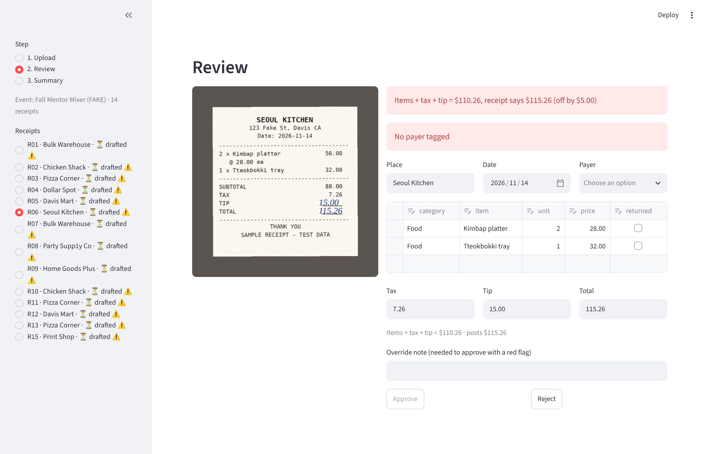

# Tallyable

A tool that turns club receipt photos into reviewed expense rows, flags errors with plain-code rules, and posts approved totals to Google Sheets. Portfolio project. **All data in this repo is fake.**

## Status
Week 1 of 4 done, plus a working review app. Week 2: the app reads receipts with Claude when an API key is set, and falls back to a stand-in AI when it is not. The Google Sheets push (week 4) is the piece left to swap in.



## Run the app
```bash
streamlit run app.py
```
Click "Use the fake event's 14 receipts instead", tag payers, Draft rows, then Review.

## Use Claude to read receipts
1. Copy `.env.example` to `.env` and paste your key after `ANTHROPIC_API_KEY=`. Git ignores `.env`; never commit it or paste it anywhere.
2. Try one receipt: `python -m treasurer.try_one fake_event/receipts/R01.jpg`
3. Score all 14 photos against the answer key: `python -m treasurer.score_all` (add `--model claude-haiku-5-5` to compare a cheaper model). Results are saved in `output/`.

Without a key, the app and tests use the stub. Tests never call the API.

## Run the tests
```bash
python -m venv .venv && source .venv/bin/activate   # Windows: .venv\Scripts\activate
pip install -r requirements.txt
pytest
```

## Layout
| Path | What |
| --- | --- |
| `treasurer/models.py` | `Receipt` with many `LineItem`s. Money is `Decimal`. |
| `treasurer/checks.py` | Six rule checks: math, missing payer, duplicate, missing receipt, unusual tax, returned item |
| `treasurer/loader.py` | Loads the fake answer key into models |
| `treasurer/extract.py` | `Extractor` interface; `StubExtractor` replays the key with 4 realistic misreads |
| `treasurer/claude_extract.py` | `ClaudeExtractor`: one vision call per receipt, prompt says transcribe and never reconcile |
| `treasurer/reader.py` | Picks Claude if `ANTHROPIC_API_KEY` is in `.env`, else the stub |
| `treasurer/try_one.py`, `score_all.py` | Read one receipt; score all of them against the answer key |
| `treasurer/score.py` | Field-level accuracy of drafts against the answer key |
| `treasurer/post.py` | Long-format transaction rows, event totals, idempotent local CSV sink |
| `app.py` | Streamlit: Upload, Review, Summary |
| `fake_event/` | 15 fake receipts, answer key, 6 planted errors (see its README) |
| `tests/` | pytest suite graded against the answer key |

## Rules
| Flag | Rule | Blocks approval |
| --- | --- | --- |
| `math_error` | items + tax + tip differs from the printed total by more than $0.01 | Yes |
| `missing_payer` | no payer | Yes |
| `possible_duplicate` | same image bytes, or same place, date and total in one event | Yes |
| `missing_receipt` | no photo | No |
| `unusual_tax` | tax over 12% of subtotal | No |
| `returned_item` | listed, cost and its tax share excluded from totals | No |

A blocking flag can be overridden only with a written note.

## Week 1 results
- All 6 planted errors caught, 0 false flags on the 9 clean receipts.
- A simulated correct review posts $571.75, matching the expected total.
