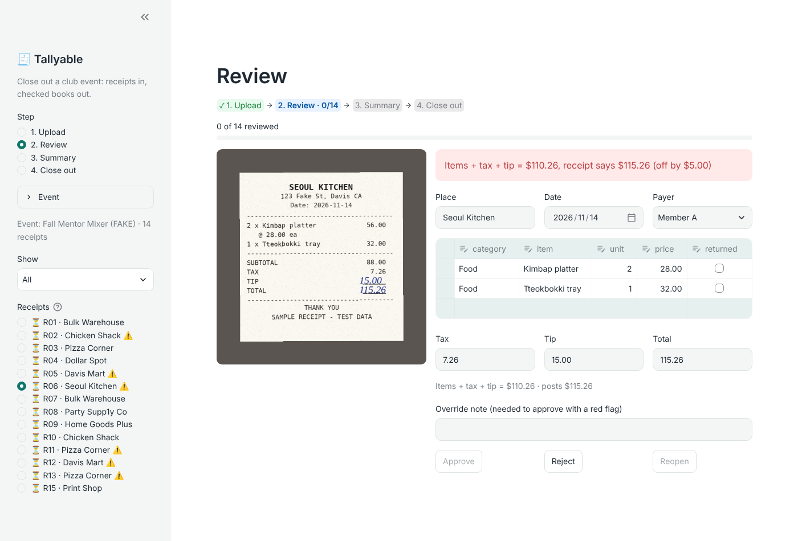
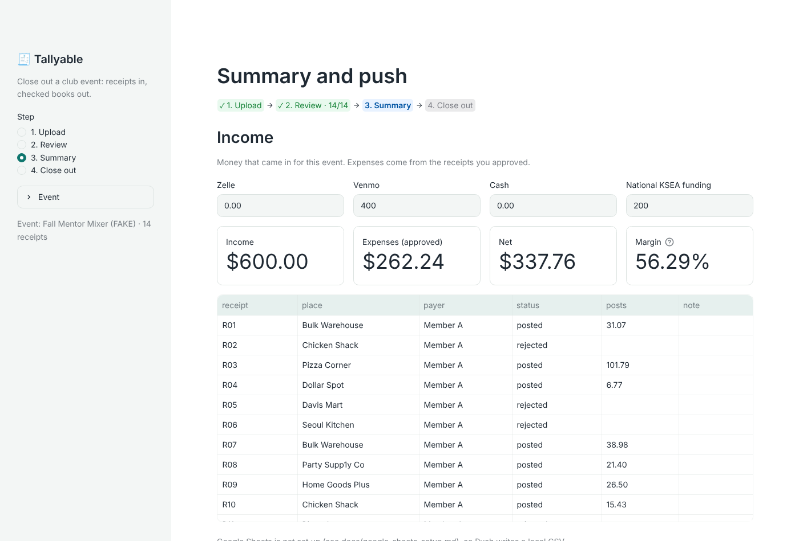
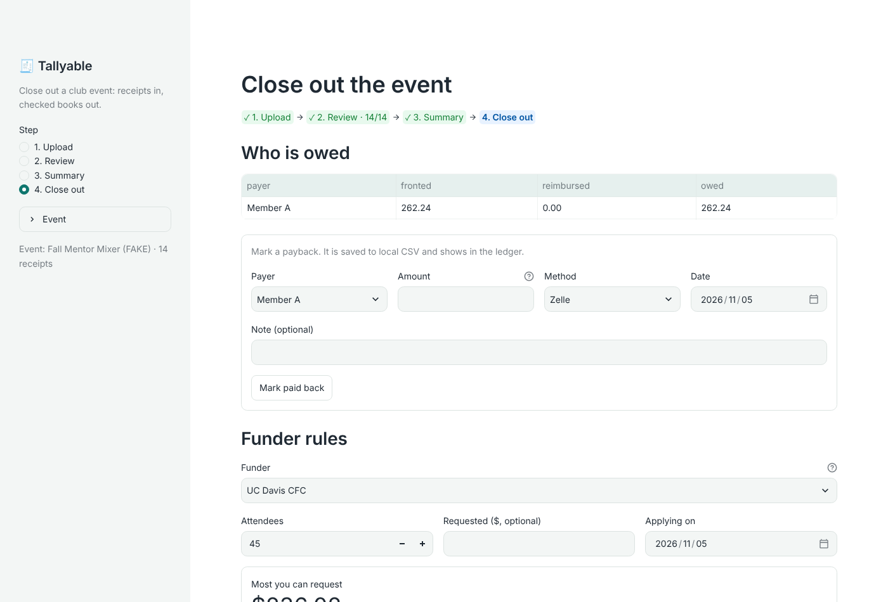
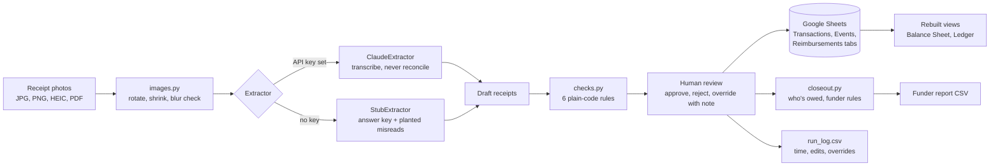

# Tallyable

[](https://github.com/bokchoi-kc0420/Tallyable/actions/workflows/tests.yml)

**Close out a club event in minutes: receipt photos in, checked expenses, who's owed, and a funder report out.**

A portfolio project by a student club treasurer. AI reads the receipts, plain code checks the math, and a human approves every row before it reaches the books. **All data in this repo is fake.**



## The problem
After a club event, the treasurer is left holding a pile of receipt photos from a group chat. Then the close-out begins:
- Type every line into the expense report, the balance sheet, and the ledger.
- Catch mistakes: a handwritten total that doesn't add up, a missing tip line, the same receipt sent twice, a purchase nobody tagged a payer on.
- Work out who fronted money and who is still owed.
- Check the funder's rules before asking for money. UC Davis CFC caps food at $12 a person, requires the club to pay at least 10%, and wants the report within 21 days.

It's slow, it's easy to get wrong, and the errors end up in official books.

## What it does
1. **Upload** receipt photos (JPG, PNG, HEIC, or PDF) and tag who paid.
2. **Draft**: Claude transcribes each receipt into line items, tax, tip, and total.
3. **Review**: six rule checks flag problems. A blocking flag can only be overridden with a written note. Every receipt gets approved or rejected by a person.
4. **Push** approved rows to Google Sheets. The tool keeps a tidy record and rebuilds the club's balance sheet and ledger layouts from it.
5. **Close out**: see who's owed, mark paybacks, check funder rules, and download the funder report.

| Summary and push | Close out |
| --- | --- |
|  |  |

## Results
Measured on the fake event: 15 receipts with 6 planted errors and an answer key ([fake_event/](fake_event/)).

| Metric | Result |
| --- | --- |
| Planted errors caught by the checks | 6 of 6, with 0 false flags on the 9 clean receipts |
| Field accuracy of AI drafts (Sonnet 5.5) | **99.5%**: every field 100% except category (96.9%, 1 of 32 lines). 0 invented lines. Run of 2026-11-05, after one prompt fix |
| Field accuracy on the held-out set (Sonnet 5.5) | _TBD: `score_all --set holdout`, 12 receipts the prompt never saw_ |
| Field accuracy (Haiku 5.5) | _TBD_ |
| API cost for the whole event | **$0.079** for 14 receipts, 33 seconds (Sonnet 5.5) |
| Time to close out by hand (Excel) | _TBD_ |
| Time to close out in Tallyable | _TBD: from `output/run_log.csv`_ |
| Edits needed per receipt | _TBD: from `output/run_log.csv`_ |
| Posted total vs expected | $571.75 = $571.75 (simulated correct review) |

**What the misses were:** the first run (99.0%) missed 2 category calls, which are judgments, not transcriptions ("Sauce cups (20)" is labeled Food and "Ice bag" is labeled Drink). The prompt now defines categories by what an item *is*, without naming either item. The rerun fixed "Ice bag" but still calls "Sauce cups" Other, which crosses the food-vs-other line funder rules use (96.9% on that split). The prompt is frozen for this set from here: tuning further would just teach it the test. Because the fix was written after seeing the misses, the honest number is the held-out set in [fake_event_holdout/](fake_event_holdout/): new stores, new items, many borderline on category ("Ice cream cups", "Water jug, empty"), labeled before any model run.

## Architecture


## Key decisions and why
- **AI only reads, code does the math.** Claude turns pixels into text. Every check is plain Python, so each flag is exact and reproducible and can be explained to a funder.
- **"Transcribe, never reconcile."** Vision models sometimes quietly change a line so the receipt adds up. The prompt forbids that, because the math check can only catch an error the model leaves in place.
- **A human approves every row.** The tool drafts and flags. It never posts on its own. Overriding a blocking flag takes a written note, which leaves an audit trail.
- **Money is `Decimal`, never float.** Cents never drift, and rounding is half-up like a cashier's.
- **The spreadsheet stays the system of record.** The club already lives in Google Sheets. Tallyable writes tidy tabs (one row per line item) and rebuilds the familiar sideways balance sheet and ledger from them, so the treasurer's layout survives and the data stays analyzable.
- **Pushing twice never double-counts.** A receipt id that's already posted is skipped.
- **A stub and an answer key from day one.** The whole app runs and is tested without an API key. A swappable `Extractor` interface means the real model drops in without changing the app, and the same answer key scores it.
- **Funder rules are data.** CFC and ORG are `RulePack` values, not code paths. A new funder means new numbers, not a rewrite.
- **Paybacks don't change expenses.** Reimbursing a member settles money the club already owes. It shows in the ledger without moving the balance.
- **Cost is a feature.** The default model is the mid-tier one. Big photos are shrunk before sending, every run prints a cost estimate, and scoring stops at a $1 budget.

## Run it
```bash
python -m pip install -r requirements.txt
python -m streamlit run app.py
```
Click "Use the fake event's 14 receipts instead", tag payers, then go through Draft, Review, Summary (push), and Close out.

- **Read receipts with Claude:** copy `.env.example` to `.env` and add `ANTHROPIC_API_KEY`. Try one receipt with `python -m treasurer.try_one fake_event/receipts/R01.jpg`, or score them all with `python -m treasurer.score_all` (`--model claude-haiku-5-5`, `--budget 0.50`, `--set holdout` for the unseen receipts). Never commit `.env`.
- **Google Sheets:** [docs/google_sheets_setup.md](docs/google_sheets_setup.md). Without it, Push writes a local CSV.
- **Put it online:** [docs/deploy_streamlit_cloud.md](docs/deploy_streamlit_cloud.md). Set `APP_PASSWORD` first.
- **HEIC photos:** `python -m pip install pillow-heif`.
- **Tests:** `python -m pytest` (100 tests with 93% coverage, run on every push; they never call the API or touch a real sheet).

## Rules
| Flag | Rule | Blocks approval |
| --- | --- | --- |
| `math_error` | items + tax + tip differs from the printed total by more than $0.01 | Yes |
| `missing_payer` | no payer | Yes |
| `possible_duplicate` | same image bytes, or same place, date and total in one event | Yes |
| `missing_receipt` | no photo | No (but funders block it) |
| `unusual_tax` | tax over 12% of subtotal | No |
| `returned_item` | listed, cost and its tax share excluded from totals | No |

Funder rules (`treasurer/closeout.py`): CFC food cap, max award, 10% club share, report due date; ORG no food, decoration warning, 42-day purchase window, receipt required.

## Layout
| Path | What |
| --- | --- |
| `app.py` | Streamlit: Upload, Review, Summary, Close out |
| `treasurer/models.py` | `Receipt` with many `LineItem`s; returned-item and posted amounts |
| `treasurer/images.py` | Upload prep: rotation, resizing, blur and size warnings, HEIC, PDF |
| `treasurer/extract.py`, `claude_extract.py`, `reader.py` | Extractor interface, stub, Claude, and the switch between them |
| `treasurer/checks.py` | The six rule checks |
| `treasurer/closeout.py` | Funder rules, who's owed, funder report |
| `treasurer/reimburse.py` | Paybacks to members |
| `treasurer/post.py`, `sheets.py` | Local CSV sink and Google Sheets sink with balance sheet and ledger views |
| `treasurer/score.py`, `score_all.py`, `try_one.py` | Accuracy against the answer key |
| `treasurer/runlog.py` | Time and edit log per push |
| `fake_event/` | 15 fake receipts, answer key, 6 planted errors |
| `fake_event_holdout/` | 12 unseen receipts for an honest accuracy score; never tune the prompt on them |
| `tests/` | pytest suite |

Interview prep: [docs/interview_notes.md](docs/interview_notes.md).

## Known limits
- One receipt paid by two people can't be split. Record it as two receipts. An exact 50/50 split gets flagged as a possible duplicate and needs a note.
- A store refund slip with a negative total can't be entered. Mark the item `returned` on the original receipt instead.
- The app works on one event at a time. Set the name, date, attendees and members in the sidebar, and use "Start a new event" when you finish one. The Sheets layer keeps every event.
- Funder rules were copied from UC Davis CSI pages on 2026-11-04. Re-check them each quarter.
